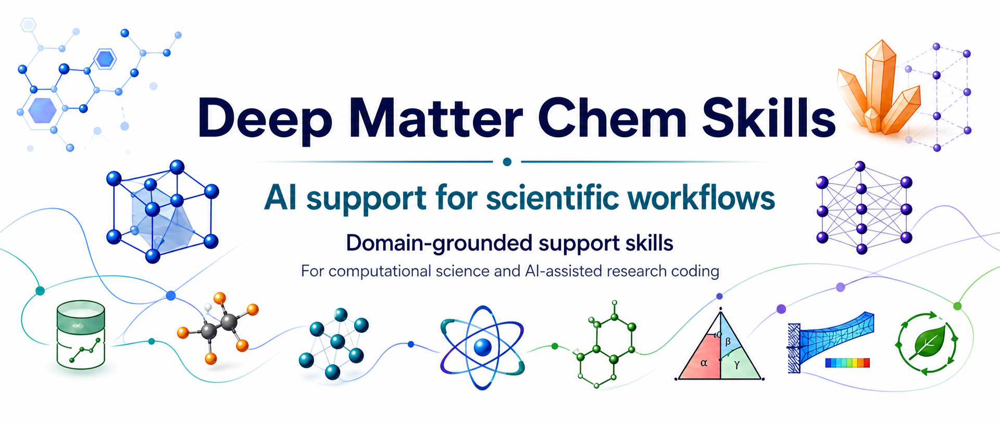
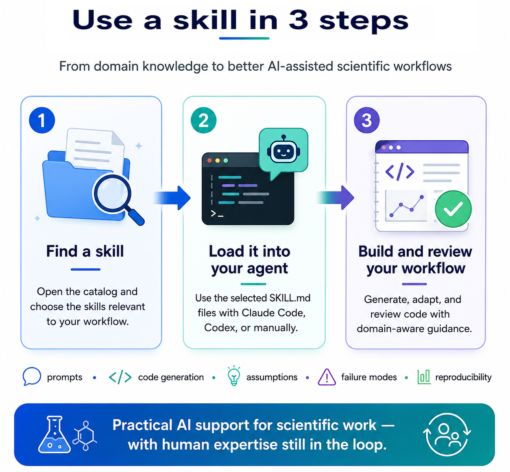

# Deep Matter Chem Skills

A production-oriented library of domain-grounded skills for AI coding agents working across computational chemistry, materials science, atomistic simulation, scientific machine learning, continuum modeling, and related research domains.

Each skill captures method assumptions, selection guidance, practical workflows, failure diagnostics, validation requirements, and connections to adjacent skills.



---

<p align="center">
  <a href="docs/skills-catalog.md"><strong>Browse Skills</strong></a> &nbsp;&bull;&nbsp;
  <a href="#quickstart"><strong>Quickstart</strong></a> &nbsp;&bull;&nbsp;
  <a href="#how-to-use-these-skills-with-ai-coding-agents"><strong>Use with AI Agents</strong></a> &nbsp;&bull;&nbsp;
  <a href="CONTRIBUTING.md"><strong>Contribute</strong></a>
</p>

## Repository at a Glance

<!-- repository-status-start -->
| Current catalog | Active pillars | Browse |
|:---:|:---:|:---:|
| **65 skills** | **15 pillars** | **[Open the generated catalog](docs/skills-catalog.md)** |
<!-- repository-status-end -->

**Latest reference-audited release:** v0.2, containing 52 production-usable support skills.

| Repository check | Status |
|---|---|
| Structural validation | Passing for the current catalog |
| Internal cross-references | Zero broken skill links |
| Reference and DOI audit | Completed for the 52-skill v0.2 release snapshot |
| Expert review | Ongoing; all skills currently remain at `draft` maturity |

> This library supports scientific workflow design, implementation, debugging, and review. It does not replace domain expertise, convergence testing, experimental validation, or final scientific judgment.

<details>
<summary><strong>Quality tiers and maturity labels</strong></summary>

| Term | Meaning |
|---|---|
| **production-usable support skill** | Structurally complete, internally linked, and ready to support Claude Code, Codex, or manual workflows. |
| **validated skill** | Independently reviewed by a domain expert and promoted beyond `draft`. No skills have reached this tier yet. |

The current `draft` tier means required sections, metadata, workflows, failure modes, and references are present, while independent expert review remains open. `[EXPERT REVIEW NEEDED]` markers identify claims that require additional scrutiny.

</details>

---

## Who This Is For

This repository is intended for:

- **Computational chemists and materials scientists** using AI coding agents for DFT, MD, thermodynamics, or electrochemistry workflows.
- **Atomistic simulation researchers** working with LAMMPS, GROMACS, VASP, Quantum ESPRESSO, CP2K, AiiDA, or related tools.
- **Scientific ML researchers** building ML interatomic potentials, PINNs, surrogate models, or active-learning pipelines.
- **Data scientists** working with materials databases, featurization pipelines, or reproducibility workflows.
- **Domain reviewers** who can confirm, improve, or correct technical claims.
- **Contributors** who want to add new skills, improve existing ones, verify references, or expand the roadmap.

---

## Quickstart

```bash
git clone https://github.com/SFETNI/Deep-Matter-Chem-Skills.git
cd Deep-Matter-Chem-Skills

# Regenerate the skill catalog
python scripts/generate_catalog.py

# Check all internal cross-references
python scripts/check_crossrefs.py

# Validate a single skill
python scripts/validate_skills.py skills/electronic-structure/vasp-workflow/SKILL.md

# Validate all skills
for f in $(find skills -name "SKILL.md" | sort); do
    python scripts/validate_skills.py "$f" || exit 1
done
```

---

## How to Use These Skills with AI Coding Agents

Skills are plain Markdown files. Use them by loading the relevant `SKILL.md` files into the context of Claude Code, Codex, or another coding agent before asking the agent to generate, review, or debug workflow code.



### Claude Code

Open Claude Code in the repository root and ask it to read the relevant skills before working.

Example prompt:

```text
Read skills/electronic-structure/vasp-workflow/SKILL.md and any linked prerequisite skills.
Use them as support material for workflow design and code generation.
Do not treat them as final authority.
Preserve [EXPERT REVIEW NEEDED] markers and flag assumptions that require domain review.
```

For repository edits, ask Claude Code to run the validation scripts before committing:

```text
After editing, run generate_catalog.py, check_crossrefs.py, and validate all changed skills.
Report files changed, validation status, catalog count, and cross-reference status.
```

### Codex or Other Coding Agents

Open the repository in the agent workspace and explicitly point the agent to the relevant skills.

Example prompt:

```text
Before writing code, inspect:
- skills/ml-interatomic-potentials/mace-training/SKILL.md
- skills/ml-interatomic-potentials/mlp-validation/SKILL.md
- skills/scientific-data/reproducibility-workflow/SKILL.md
Use these skills as implementation guidance.
Report any assumptions, uncertain claims, and required validation steps.
```

For changes to the repository, require the agent to report:

* Changed files.
* Validation commands run.
* Catalog count.
* Cross-reference status.
* Any new `[EXPERT REVIEW NEEDED]` markers.
* Any references added or corrected.

### Manual Use Without an Agent

1. Open [docs/skills-catalog.md](docs/skills-catalog.md).
2. Identify the skills relevant to your workflow.
3. Read the relevant `SKILL.md` files.
4. Use the workflows, failure modes, best practices, and references as structured checklists.
5. Check assumptions and parameter choices against your system, software version, and domain requirements.

---


The skills support reasoning, implementation, review, and diagnostics. They do not replace expert judgment, physical validation, convergence testing, or experimental confirmation.

---

## Pillars Currently Covered

| Pillar                       | Skills | Domain coverage                                                                                                    |
| ---------------------------- | -----: | ------------------------------------------------------------------------------------------------------------------ |
| `electronic-structure`       |     11 | VASP, Quantum ESPRESSO, CP2K, AiiDA, DFT convergence, phonons, surfaces, defects, high-throughput DFT, EOS fitting |
| `atomistic-md`               |      9 | GROMACS, LAMMPS, force fields, equilibration, free energy, enhanced sampling, coarse-grained MD, reactive MD       |
| `ml-interatomic-potentials`  |      9 | MACE, NequIP, universal potentials, fine-tuning, active learning, validation, uncertainty, LAMMPS deployment       |
| `scientific-data`            |      6 | ASE, pymatgen, materials databases, featurization, visualization, reproducibility                                  |
| `geometric-deep-learning`    |      3 | Crystal GNNs, molecular GNNs, MatGL/M3GNet                                                                        |
| `surrogate-active-learning`  |      5 | Gaussian processes, Bayesian optimization, surrogate validation                                                    |
| `scientific-ml`              |      2 | PINNs, small-data ML                                                                                               |
| `electrochemistry-corrosion` |      2 | Battery materials workflows, corrosion and electrochemistry                                                        |
| `cheminformatics`            |      3 | Molecular featurization, molecular datasets                                                                        |
| `thermodynamics-calphad`     |      1 | CALPHAD workflows                                                                                                  |
| `sustainability-lca`         |      1 | Materials life-cycle assessment                                                                                    |
| `phase-field-microstructure` |      4 | Cahn-Hilliard and Allen-Cahn workflows with FiPy                                                                   |
| `continuum-modeling`         |      5 | FEM multiphysics                                                                                                   |
| `computational-chemistry`    |      1 | Molecular quantum chemistry workflows with ORCA, xTB, TDDFT                                                       |
| `generative-matter`          |      3 | Crystal diffusion generative models, including MatterGen and DiffCSP                                               |

---

## Skill Catalog

The full catalog is available at [docs/skills-catalog.md](docs/skills-catalog.md).

The catalog is generated automatically and lists every skill with its pillar, maturity, tools, GPU requirement, and estimated runtime.

Regenerate after adding or modifying skills:

```bash
python scripts/generate_catalog.py
```

---

## Maturity Model

Skills use five internal maturity labels:

```text
planned → stub → draft → validated → flagship
```

The current release uses `draft` as the entry-level production-support tier. In this repository, `draft` means:

* the skill is structurally complete;
* required sections and metadata are present;
* workflows, failure modes, and references are included;
* internal links resolve;
* the skill remains open to independent expert review.

`draft` does **not** mean the skill is unusable. It means the skill has not yet been promoted through documented external review.

See [docs/maturity-model.md](docs/maturity-model.md) for promotion criteria and tier definitions.

---

## Review Status

The repository is intentionally transparent about review status.

| Review surface            | Current status                        |
| ------------------------- | ------------------------------------- |
| Structural validation     | Passing for the current catalog       |
| Internal cross-references | Zero broken skill links               |
| Catalog generation        | Generated from the current skill tree |
| Expert review             | Ongoing; community review welcome     |
| Reference and DOI audit   | Completed for v0.2; corrections still welcome         |
| Maturity promotions       | No skills promoted beyond `draft` yet |

Many skills intentionally contain `[EXPERT REVIEW NEEDED]` markers. These markers identify parameter choices, software-version details, reference-sensitive claims, and domain-specific recommendations that benefit from additional expert review.

The project owner has reviewed selected skills in areas aligned with his expertise, including materials modeling, atomistic simulation, phase-field methods, FEM, CALPHAD, electrochemistry/corrosion, sustainability, and scientific ML workflows. Other skills remain open for specialist review.

---

## Quality Checks

Three scripts cover the main verification surface:

| Script                        | What it checks                                                    |
| ----------------------------- | ----------------------------------------------------------------- |
| `scripts/validate_skills.py`  | Schema, required sections, heading names, and front-matter fields |
| `scripts/generate_catalog.py` | Renders all skills to `docs/skills-catalog.md`                    |
| `scripts/check_crossrefs.py`  | Confirms all internal `SKILL.md` links resolve to existing files  |

Recommended checks before committing:

```bash
python scripts/generate_catalog.py
python scripts/check_crossrefs.py
for f in $(find skills -name "SKILL.md" | sort); do
    python scripts/validate_skills.py "$f" || exit 1
done
```

---

## Reference Integrity

Citation and DOI metadata are part of the review surface.

If a reference title, DOI, author list, year, journal, or landing page does not match what is claimed in a skill, report it using the GitHub issue template for broken references:

[Report a reference issue](https://github.com/SFETNI/Deep-Matter-Chem-Skills/issues/new/choose)

Useful reports include:

* skill path;
* exact reference text;
* DOI or URL currently listed;
* expected paper title or authors;
* actual page opened;
* whether the reference supports a technical claim.

---

## Roadmap

The v0.2 reference-audited release contains 52 skills. Development continues beyond that release snapshot, and the longer-term roadmap targets approximately 100+ skills across additional computational and materials-science domains.

Priority expansion areas include:

| Direction                            | Likely additions                                                                        |
| ------------------------------------ | --------------------------------------------------------------------------------------- |
| Computational chemistry              | Multireference methods, reaction path workflows, solvation models, NMR and spectroscopy |
| Cheminformatics                      | Reaction informatics, SMILES/SMARTS workflows, retrosynthesis tools                     |
| Reaction thermodynamics and kinetics | Cantera workflows, microkinetic modeling, TST/RRKM                                      |
| Electrochemistry and catalysis       | Electrocatalysis descriptors, Butler-Volmer workflows, explicit-solvent DFT             |
| Continuum mechanics                  | Plasticity, fatigue, creep, fracture mechanics, homogenization                          |
| Process modeling and sustainability  | LCA integration, TEA workflows, process simulation                                      |
| Generative matter                    | Molecule generation, inverse design, property-conditioned generation                    |
| Scientific ML and operator learning  | DeepONet, Fourier neural operators, graph-based surrogates                              |
| Experimental-data integration        | EXAFS, XRD, PDF, experimental featurization pipelines                                  |
| Materials informatics                | High-throughput screening, feature importance, Pareto-front analysis                    |

Planned roadmap areas may be mentioned in prose before they exist as skills. Internal `SKILL.md` links should point only to skills that already exist in the repository.

---

## Contributing

Contributions are welcome.

Useful contributions include:

* new skills in covered or uncovered pillars;
* improvements to workflows, examples, or failure-mode tables;
* corrections to numerical claims, convergence thresholds, or tool defaults;
* DOI and reference title corrections;
* expert reviews of skills containing `[EXPERT REVIEW NEEDED]` markers;
* roadmap suggestions and domain coverage proposals;
* validation, catalog, or tooling improvements.

GitHub issue templates and a pull request template are available. See [CONTRIBUTING.md](CONTRIBUTING.md) for contribution rules, skill authoring requirements, and the review process.

---

## Release and Launch Notes

Release preparation materials are available in:

* [docs/release-checklist.md](docs/release-checklist.md)
* [docs/github-launch-plan.md](docs/github-launch-plan.md)

These documents describe the release checks, launch workflow, and post-launch priorities.

---

## License

See [LICENSE](LICENSE).
